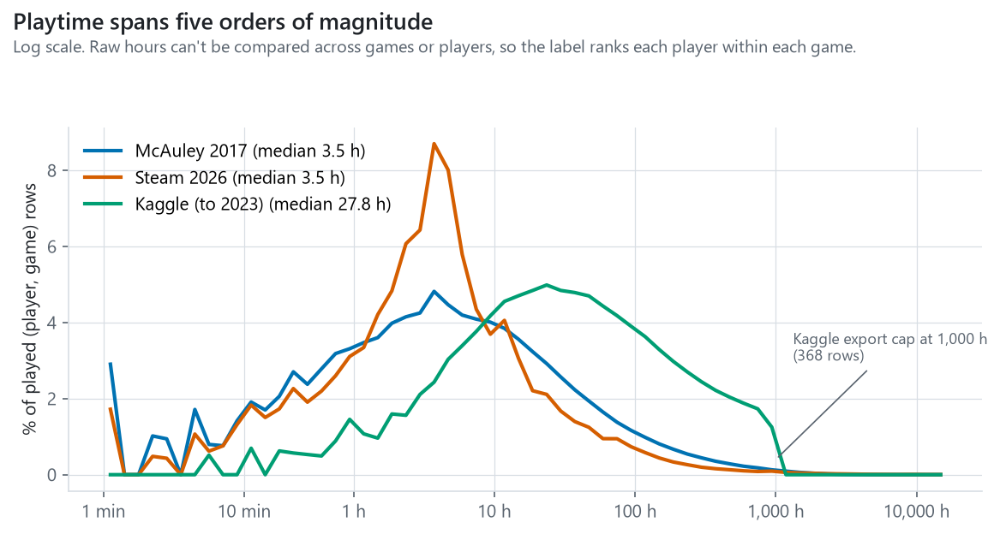
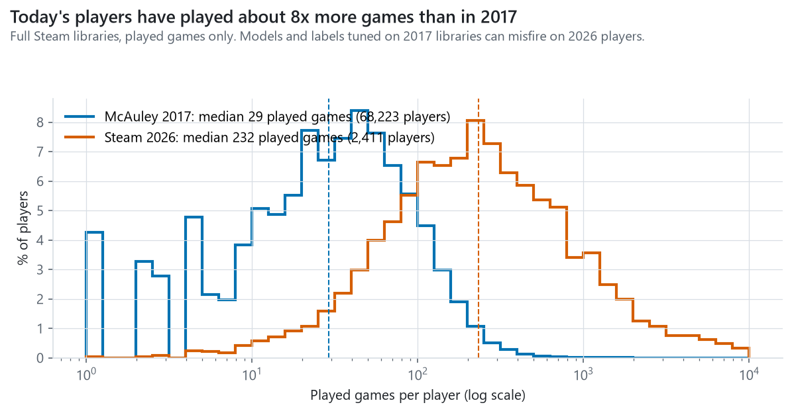
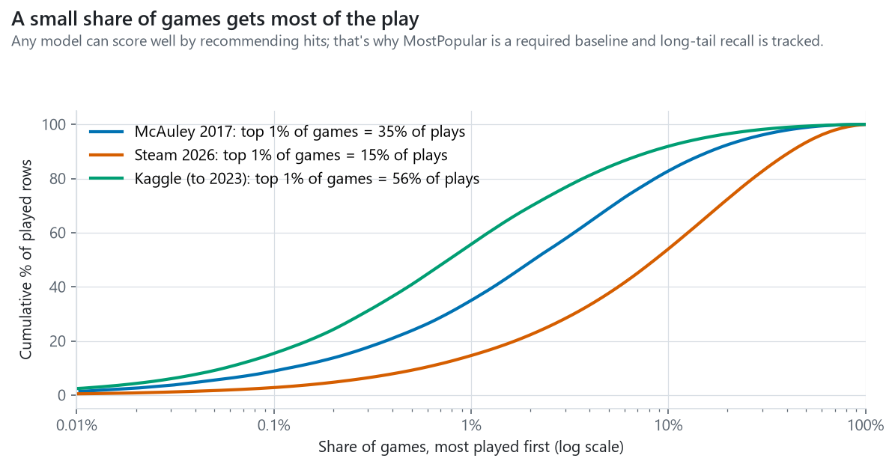
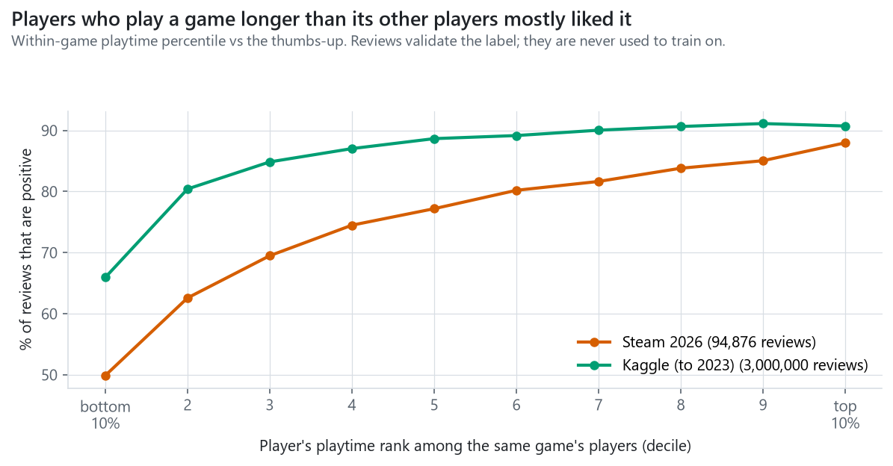
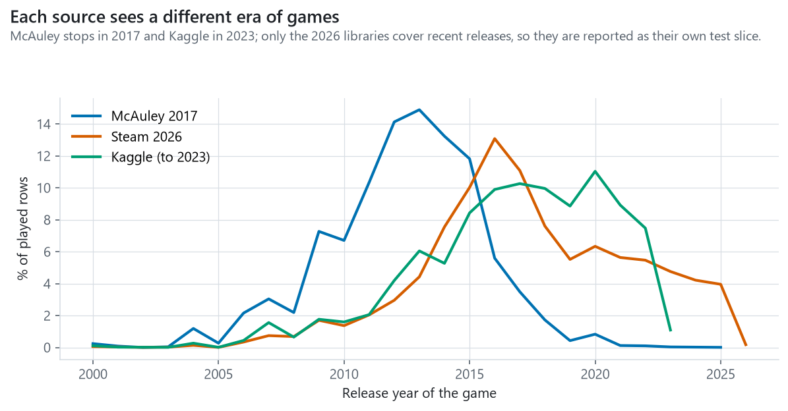

# 1. Goal and data

The recommender takes a player's Steam library and suggests games they are likely to enjoy. Most players never write
reviews, so "enjoyed" has to come from behavior: how long someone played a game compared with the game's other players.
Three sources supply that behavior, each with a different role.

| Source | What it holds | Players | Played rows | Role |
|---|---|---|---|---|
| McAuley Australian Steam (2017) | Full libraries, played and unplayed | 68k | 3.2 M | Primary training and evaluation (closest to a live user) |
| Steam 2026 (our collection) | Full public libraries of recent reviewers, collected through Steam's official API | 2.4k | 1.4 M | Modern players: own test slice and label re-test |
| Kaggle Steam reviews (to Oct 2023) | Reviewed games only, hours at review time | 13.7 M | 40.4 M | Extra training rows; label validation |

A merged game catalog (137,725 apps) joins Kaggle's 2023 catalog, FronkonGames' October 2026 store crawl, McAuley's
metadata and Steam's app list. 111,167 apps are marked recommendable (a game, on sale, released, not sexually explicit).

# 2. Preparation

`clean/build_clean.py` rebuilds every table from the raw files and runs 21 automatic checks; all pass
(`clean/audit_report.md`). Each rule is logged with the rows it touched and why (`clean/cleaning_report.md`). The main
decisions:

- **Keep, flag, don't delete.** Zero-playtime rows, DLC, delisted games and bulk reviewers stay in the data with a flag,
  because they still describe what a player owns. Only rows that cannot be used are dropped: 41 Kaggle rows (duplicates
  and two scripted accounts) and one untitled app. Kaggle reconciles 41,154,794 → 41,154,753 rows.
- **Zero playtime means unknown, not disliked** (1.85 M unplayed McAuley rows; 176k Kaggle reviews with 0 hours).
- **Censoring.** Kaggle's export stops at 1,000 hours (368 played rows flagged `censored`).
- **Text repair.** HTML entities and hidden characters removed from 322 titles and 1,956 descriptions; raw titles kept.
- **What can be recommended.** Playtest builds (8,131), sexually explicit games (4,593) and delisted games are excluded
  from recommendations but kept as play history.
- **Privacy.** Our 2026 collection stores only salted SHA-256 hashes of Steam IDs and no review text.

The data dictionary (`clean/data_dictionary.md`, also `.csv`) lists every table's grain and every column's type,
missing rate, example and meaning.

# 3. What the data shows

Figures 1-5 are in the appendix and on the dashboard.

**Figure 1. Playtime spans five orders of magnitude.** The median played game gets 3.5 hours in both full-library
sources, but 27.8 hours in Kaggle, because people mostly review games they played a lot. Raw hours therefore can't be
compared across games (a 2-hour puzzle game versus a 2,000-hour shooter) or across sources. The label ranks each player
among the same game's players instead.

**Figure 2. Today's players have played about 8x more games.** The median 2026 player has played 232 games versus 29 in
2017. This explained a real result: an enjoyment score tuned on 2017 libraries (adjusting for each player's habits)
scored 0.727 AUC on 2017-style data but lost to plain playtime on 2026 players (0.659 vs 0.693). We adopted the simple
within-game percentile and made 2026 players their own test slice.

**Figure 3. A few games take most of the play.** The top 1% of games hold 56% of Kaggle plays and 35% of McAuley
plays. A model can look accurate by recommending hits, so MostPopular is a required baseline and long-tail recall is
reported in Layer 2.

**Figure 4. The label works.** Among 94,876 unbiased 2026 reviews, players in the bottom 10% of a game's playtime left a
positive review 50% of the time; players in the top 10%, 88%. Kaggle shows the same rise (66% to 91%). Refunded games are
29% positive versus 76% overall. Reviews are used only to check the label, never to train on.

**Figure 5. Each source sees a different era.** McAuley plays center on 2012-2015 releases and stop in 2017; Kaggle
stops in 2023. Only our 2026 libraries cover recent releases.

# 4. Data-quality and sampling concerns

1. **Reviewers are not typical players.** Kaggle holds only reviewed games, and reviewers play more (Figure 1). Label
   validation uses reviews, so it describes reviewers; the planned user study tests non-reviewers directly.
2. **Era drift.** 2017 libraries are smaller and older (Figures 2 and 5). Results are reported separately for 2026
   players, and models must hold up there.
3. **Our own collection's sampling.** The collector took one page of recent reviews and one page of recent negative
   reviews per game. The negative page reaches further back in time, which leaked review age into recency features
   (they looked strong, AUC 0.76, and vanished on the unbiased page). Prolific reviewers also appeared under many games.
   All 2026 analyses use the unbiased page and one review per reviewer.
4. **Kaggle playtime is measured at review time and capped at 1,000 h,** so it understates lifetime play.
5. **Catalog gaps.** 66% of recommendable games have no user tags. The FronkonGames copy we used (from Hugging Face) has an empty tags column, and only 11% of Kaggle's games lack tags. Genres, missing for only 0.2% of games, are used instead.
6. **Price column.** `price_regular` prefers the October 2026 store crawl, which often captured sale prices (for example
   $5.99 for a $59.99 game). The live tool uses current store prices; the value-per-dollar metric will use
   max(2023 regular, 2026 crawl) until the cleaning rule is fixed.
7. **Unplayed games are ambiguous** (gift, bundle, or not started yet), so they are excluded from hits and misses.

# 5. Reserved test data

Before any model comparison, players were split by a fixed rule, `sha256("steamrec-split-v1|source|player") mod 10`:
0 = test, 1 = validation, 2-9 = train, within each source. Players already examined in earlier checks were moved from
test to validation. For test and validation players, about 20% of played games are hidden by the same kind of rule, so
every model is scored on the same hidden games. Test players are removed from all training, and the test set is scored
once at the end. The full protocol is frozen in `eval/PROTOCOL.md`; split files carry SHA-256 checksums in
`data_clean/splits/manifest.json`.

| Source | Test players | Test, 5+ visible games | Validation players | Validation, 5+ visible games |
|---|---|---|---|---|
| McAuley 2017 | 6,265 | 5,002 | 7,377 | 6,099 |
| Steam 2026 | 187 | 184 | 308 | 308 |
| Kaggle (secondary) | 1,368,763 | 111,930 | 1,367,004 | 111,178 |

534 previously examined players moved from test to validation, which is why the 2026 test slice (187) is smaller than
10%. Most Kaggle players reviewed fewer than five games, so they mainly feed the 1-4 game row of the results.

# 6. Reproducing this

| Step | Command (ML virtual environment) | Output |
|---|---|---|
| Clean and audit | `python clean/build_clean.py`, `python clean/audit_clean.py` | `data_clean/*.parquet`, reports |
| Data dictionary | `python clean/data_dictionary.py` | `clean/data_dictionary.md/.csv` |
| Reserve test data | `python clean/reserve_test.py` (runs once; refuses to overwrite) | `data_clean/splits/` |
| Figures | `python eda/d2_figures.py` | `eda/figures/`, `eda/d2_tables/` |
| Dashboard data | `python dashboard/load_supabase.py` | Supabase `public.eda_*` |
| Dashboard | `modal deploy dashboard/modal_app.py` | Streamlit app on Modal |

# Appendix: figures

{width=6in}

{width=6in}

{width=6in}

{width=6in}

{width=6in}

