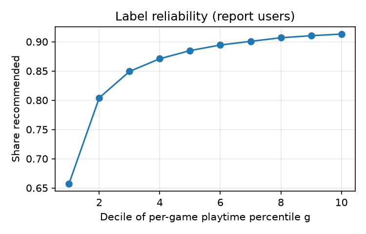

# Layer 1: playtime 'enjoyed' label vs Kaggle reviews

- Rows: 41,154,794; zero-playtime rows dropped as *unknown*: 176,329; hours at the 1000 h cap (censored): 372
- Games: 37,528; rows in games with < 20 players (shrunk toward main tag): 129,024
- Calibration users' rows: 20,493,163; report users' rows: 20,485,302
- Recommended share: 85.9%  (why raw agreement is meaningless here)

## Binary label vs review flag (report users only)

| variant      |   cutoff (chosen on calib) |   kappa |   raw agreement |   enjoyed share |   sensitivity |   specificity |   Youden J |          TP |          FP |          FN |     TN |
|:-------------|---------------------------:|--------:|----------------:|----------------:|--------------:|--------------:|-----------:|------------:|------------:|------------:|-------:|
| A_floor      |                      nan   |  0.2024 |          0.837  |          0.9116 |        0.9357 |        0.2352 |     0.1709 | 1.64686e+07 | 2.20639e+06 | 1.13192e+06 | 678409 |
| B_ratio      |                        0.2 |  0.2141 |          0.8171 |          0.8721 |        0.9011 |        0.3048 |     0.2059 | 1.58601e+07 | 2.00556e+06 | 1.74037e+06 | 879237 |
| C_percentile |                        0.1 |  0.2078 |          0.8236 |          0.8861 |        0.9131 |        0.2781 |     0.1912 | 1.60702e+07 | 2.08243e+06 | 1.53031e+06 | 802366 |

## Kappa at every cutoff tried (calibration users)

Shows how far the framework's default (percentile 0.5) is from the kappa-best cutoff.

|                        |   kappa (calib) |   enjoyed share |
|:-----------------------|----------------:|----------------:|
| ('A_floor', nan)       |          0.2033 |          0.9117 |
| ('B_ratio', 0.02)      |          0.0939 |          0.9819 |
| ('B_ratio', 0.05)      |          0.1606 |          0.9595 |
| ('B_ratio', 0.1)       |          0.2016 |          0.9279 |
| ('B_ratio', 0.15)      |          0.2135 |          0.8988 |
| ('B_ratio', 0.2)       |          0.2142 |          0.8722 |
| ('B_ratio', 0.3)       |          0.2048 |          0.821  |
| ('B_ratio', 0.5)       |          0.1715 |          0.7287 |
| ('B_ratio', 0.8)       |          0.1206 |          0.5883 |
| ('B_ratio', 1.0)       |          0.0926 |          0.5049 |
| ('B_ratio', 1.5)       |          0.0523 |          0.3466 |
| ('C_percentile', 0.02) |          0.1936 |          0.9382 |
| ('C_percentile', 0.05) |          0.2038 |          0.9235 |
| ('C_percentile', 0.1)  |          0.2081 |          0.8862 |
| ('C_percentile', 0.15) |          0.1984 |          0.8429 |
| ('C_percentile', 0.2)  |          0.1845 |          0.7963 |
| ('C_percentile', 0.3)  |          0.151  |          0.6994 |
| ('C_percentile', 0.4)  |          0.1196 |          0.5996 |
| ('C_percentile', 0.5)  |          0.0921 |          0.4997 |
| ('C_percentile', 0.6)  |          0.0683 |          0.3996 |
| ('C_percentile', 0.7)  |          0.0477 |          0.2997 |

## Graded scores (report users only)

ROC-AUC for detecting *not recommended* equals the ROC-AUC above (same ranking, flipped), so the minority class is shown with PR-AUC, which does change and should be read against its prevalence baseline.

| score                    |   ROC-AUC (recommended) |   PR-AUC for NOT recommended (minority) |   PR-AUC baseline (prevalence) |
|:-------------------------|------------------------:|----------------------------------------:|-------------------------------:|
| raw hours                |                  0.6258 |                                  0.2619 |                         0.1408 |
| median ratio             |                  0.6467 |                                  0.2836 |                         0.1408 |
| game percentile g        |                  0.6448 |                                  0.265  |                         0.1408 |
| user percentile u        |                  0.5943 |                                  0.2082 |                         0.1408 |
| graded relevance (0/1/2) |                  0.5975 |                                  0.174  |                         0.1408 |

## Reliability: share recommended by decile of game percentile g

|   decile of g |   share recommended |        rows |
|--------------:|--------------------:|------------:|
|             0 |              0.6572 | 2.04854e+06 |
|             1 |              0.8041 | 2.04853e+06 |
|             2 |              0.8493 | 2.04858e+06 |
|             3 |              0.8709 | 2.04848e+06 |
|             4 |              0.8849 | 2.04855e+06 |
|             5 |              0.8944 | 2.04852e+06 |
|             6 |              0.9007 | 2.04853e+06 |
|             7 |              0.9068 | 2.04853e+06 |
|             8 |              0.9103 | 2.04853e+06 |
|             9 |              0.9131 | 2.04853e+06 |

## Graded relevance distribution (all rows)

|    |     rows |
|---:|---------:|
|  0 | 20504060 |
|  1 | 12410750 |
|  2 |  8063655 |

## Decision

- Highest kappa: **B_ratio** (kappa 0.214). The planned rule is C_percentile (cutoff 0.1).
- Limit: every Kaggle row is a reviewer, a self-selected and more engaged group, so this agreement is an upper bound for silent players.
- These cutoffs are frozen in label_config.json before any model tuning.